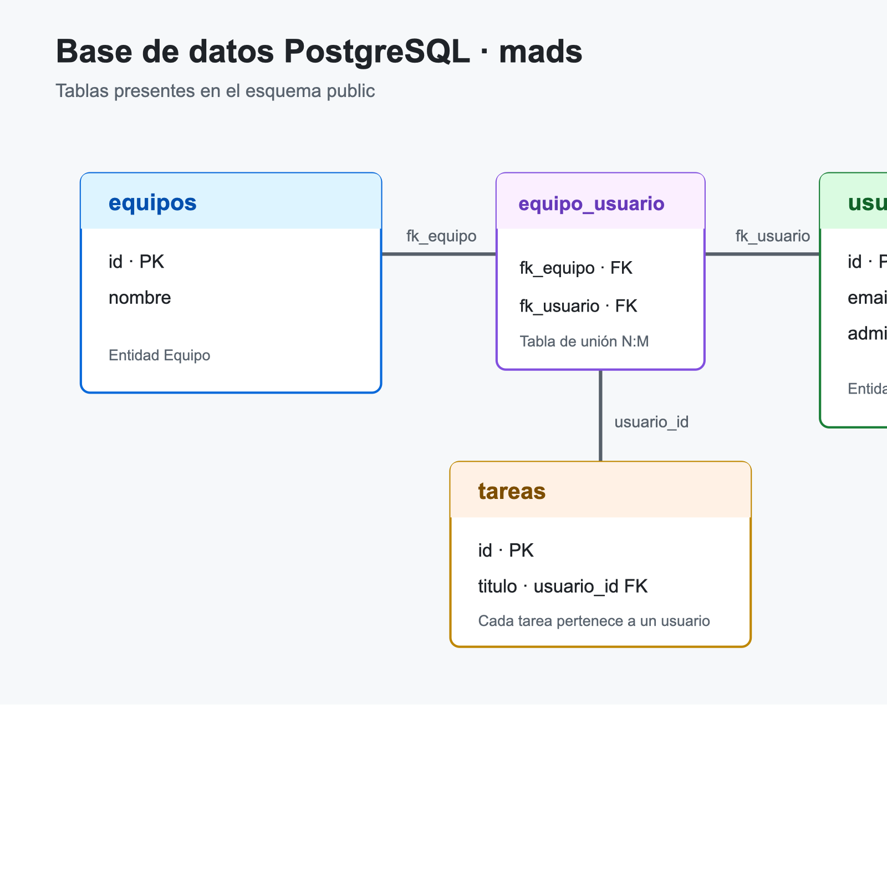

# Documentación técnica de la práctica 3

Esta documentación describe las historias 009 y 010 de la aplicación ToDoList. Se mantiene la arquitectura existente: las entidades JPA representan los datos persistidos, los servicios concentran las reglas y transacciones, los controladores atienden las peticiones web y las plantillas Thymeleaf presentan los datos. Los controladores no acceden directamente a los repositorios.

## Historia 009: pertenencia a equipos

La entidad `Equipo` se relaciona con `Usuario` mediante una relación muchos-a-muchos. La tabla `equipo_usuario` almacena las claves de ambos lados. Los métodos `addUsuario` y `removeUsuario` actualizan las dos colecciones en memoria; esto es necesario porque JPA no sincroniza automáticamente el lado inverso. En particular, al abandonar un equipo también se elimina la referencia del conjunto de equipos del usuario.

`EquipoService` proporciona las operaciones transaccionales `crearEquipo`, `añadirUsuarioAEquipo` y `quitarUsuarioDeEquipo`. Las consultas de listados usan transacciones de solo lectura, recuperan los DTO y ordenan los equipos por nombre. Si el identificador de un equipo o usuario no existe, el servicio lanza `EquipoServiceException`; la capa web traduce el error correspondiente a HTTP 404.

En `EquipoController`, `GET /equipos` muestra los equipos y determina para el usuario de la sesión cuáles tienen la acción de unirse o abandonar. `POST /equipos` crea un equipo; `POST /equipos/{id}/miembros` inscribe al usuario actual, y `POST /equipos/{id}/miembros/salir` lo elimina. En ambas operaciones el identificador de usuario procede de `ManagerUserSession`, nunca de un parámetro del cliente. `GET /equipos/{id}/usuarios` muestra sus miembros. Las plantillas `listaEquipos.html` y `usuariosEquipo.html` proporcionan las vistas. Todas estas rutas redirigen al login si no hay sesión.

## Historia 010: gestión administrativa

La ampliación añade `Equipo.setNombre` y las operaciones `cambiarNombreEquipo` y `eliminarEquipo` en `EquipoService`. La primera modifica el nombre de la entidad dentro de una transacción. Antes de borrar un equipo, la segunda itera sobre sus miembros, retira cada relación por ambos lados y elimina la entidad; así no quedan filas huérfanas en la tabla intermedia.

`POST /equipos/{id}/nombre` recibe el nuevo nombre y `POST /equipos/{id}/eliminar` elimina el equipo. Antes de invocar el servicio, ambas rutas consultan el usuario de la sesión y exigen que su indicador `administrador` esté activo. Una sesión anónima se redirige a `/login`; una cuenta inexistente o no administradora recibe HTTP 403, y un equipo inexistente produce HTTP 404. En `listaEquipos.html`, los formularios para renombrar y eliminar sólo se renderizan para administradores. La autorización vuelve a comprobarse en el servidor, por lo que ocultar los controles no constituye la única protección.

## Pruebas y base de datos

`EquipoServiceTest` verifica la actualización del nombre, la eliminación del equipo y la limpieza de las relaciones del usuario, además de las operaciones de pertenencia ya existentes. Los ciclos TDD separan el test fallido de la implementación. `EquipoControllerTest` cubre las acciones administrativas, la autorización de administradores, la denegación a usuarios normales, las redirecciones anónimas y los errores 404. La suite completa se ejecuta con `./mvnw test`; GitHub Actions también ejecuta los tests del desarrollador y los de integración con PostgreSQL.

La base de datos PostgreSQL de desarrollo se inspeccionó con `psql` en la base `mads`. Las tablas presentes son `equipos`, `equipo_usuario`, `usuarios` y `tareas`. El diagrama siguiente representa la estructura consultada: `equipo_usuario` conecta equipos y usuarios, mientras que cada tarea mantiene su referencia al usuario propietario.

El esquema conserva equipos sin miembros y usuarios que pertenecen a varios equipos. La tabla intermedia permite que una operación de baja de equipo elimine todas sus asociaciones en una única transacción.
