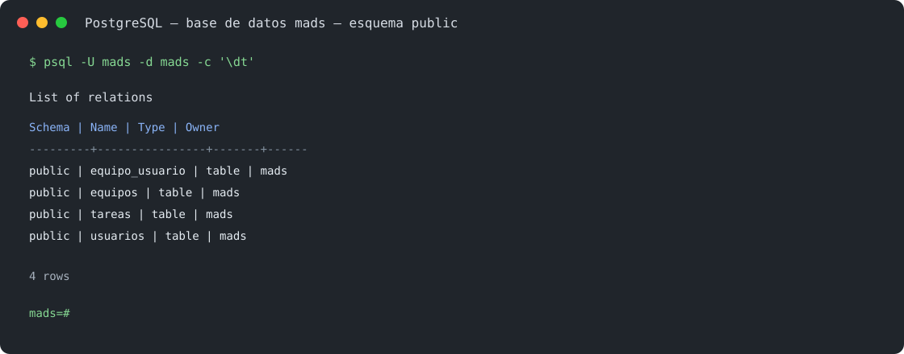

# Práctica 3 — TDD e integración continua

## Historias 009 y 010

La versión 1.2.0 incorpora equipos relacionados con usuarios mediante una relación muchos-a-muchos. La entidad `Equipo` es propietaria de la relación y declara la tabla `equipo_usuario`; `Usuario` mantiene el lado inverso. Ambas colecciones se actualizan desde los métodos de dominio `addUsuario` y `removeUsuario`, evitando que la memoria y la base de datos queden desincronizadas. La carga es `LAZY`: los miembros y equipos asociados se consultan solamente cuando el servicio los necesita.

La base de desarrollo PostgreSQL contiene `equipos`, `usuarios`, `tareas` y la tabla intermedia `equipo_usuario`. La imagen siguiente recoge la salida de la consulta `\dt` ejecutada sobre la base `mads`:



### 009 — Gestionar pertenencia al equipo

`EquipoService` permite crear equipos, añadir un usuario y eliminarlo. Los métodos de escritura usan `@Transactional`; las consultas de miembros ejecutan su conversión a DTO dentro de transacciones de solo lectura. `EquipoData` y `UsuarioData` impiden exponer entidades JPA a la capa web. `EquipoServiceTest` verifica creación, orden alfabético, consulta en ambos sentidos y que al salir se vacíen las dos colecciones.

`EquipoController` sirve `GET /equipos`, `POST /equipos`, `POST /equipos/{id}/usuarios` y `POST /equipos/{id}/usuarios/salir`. La página `listaEquipos.html` muestra los nombres, permite crear un equipo y presenta el botón para unirse o salir según la pertenencia actual. Las acciones exigen una sesión; el identificador del usuario se toma de `ManagerUserSession`, nunca de un parámetro enviado por el navegador. La página `listaUsuariosEquipo.html`, servida por `GET /equipos/{id}`, muestra los integrantes. `EquipoControllerTest` prueba las vistas y que las acciones envían al servicio el usuario de la sesión.

El cambio de pertenencia actualiza ambos lados de la relación:

```java
public void removeUsuario(Usuario usuario) {
    usuarios.remove(usuario);
    usuario.getEquipos().remove(this);
}
```

### 010 — Gestión de equipos

`EquipoService.modificarNombreEquipo` cambia el nombre y `eliminarEquipo` elimina primero las filas de la relación y después el equipo mediante JPA. Los nombres nulos o en blanco generan `EquipoServiceException`. Las pruebas de servicio comprueban el renombrado, el borrado con miembros y la validación.

La gestión queda reservada al administrador. El issue de alta de administrador se completó como prerrequisito: `Usuario` y `UsuarioData` incorporan el indicador, el formulario solo presenta la casilla mientras no exista administrador y el servicio vuelve a comprobar la unicidad al registrar. Tras iniciar sesión, el administrador se dirige a `/registrados`. En la vista de equipos, `listaEquipos.html` muestra los formularios de renombrado y eliminación únicamente a este rol. `EquipoController` valida la sesión y el rol del lado servidor en cada POST; un usuario autenticado sin permisos recibe HTTP 403. Las pruebas `EquipoControllerTest` cubren la autorización, los cambios y la ausencia de controles para usuarios normales.

Los perfiles `postgres` separan la base `mads` de desarrollo y `mads_test` de integración. GitHub Actions ejecuta tanto los tests del desarrollador con H2 como los tests de integración con PostgreSQL 13. Los servicios y relaciones se comprobaron en ambas configuraciones antes de generar la release.

Los workflows se ejecutan en pushes y pull requests. El perfil de integración recibe el hostname del servicio PostgreSQL mediante `POSTGRES_HOST`; usuario, contraseña y puerto admiten valores configurables sin cambiar los ficheros. Durante TDD, cada prueba de repository se ejecutó en transacción, mientras que las de servicio ejercitaron los límites transaccionales reales. Los tests web verifican tanto las plantillas renderizadas como los redirects y permisos.
